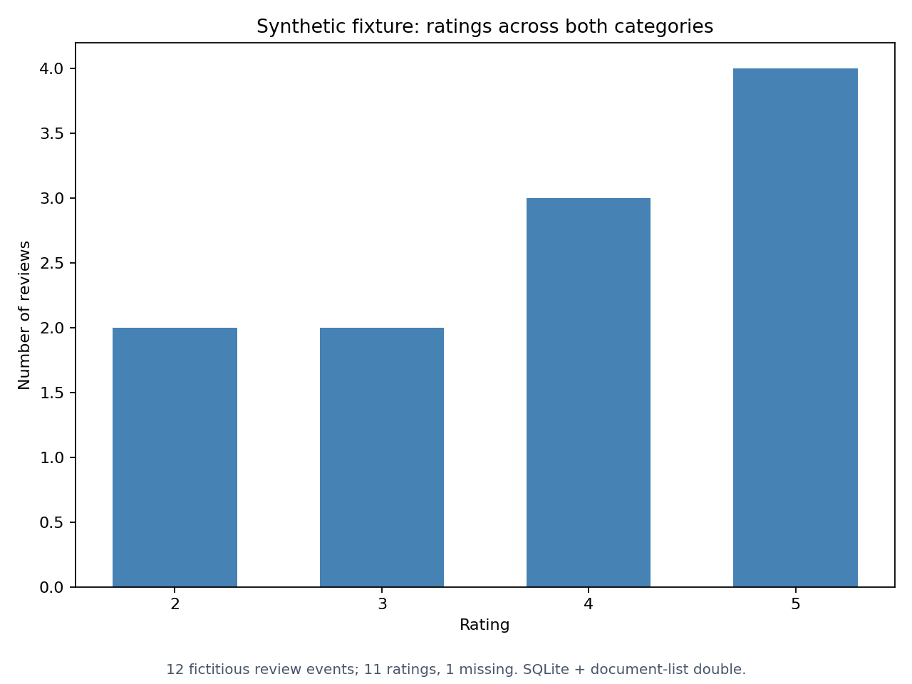

# Amazon review databases

A comparison of relational, document and graph models for product reviews. This
two-student Databases project stores structured fields in MySQL and review text
in MongoDB, then builds four alternative Neo4j graphs. We implemented the loading
workflow, queries, graph construction and seven visualisations.

The repository includes a small **invented review dataset** and an offline example
that does not need database servers.

[Try the example](#how-to-run) · [Database services](#connect-local-database-services) · [Code](#repository-structure) · [Limits](#interpretation-and-limits)

<a href="docs/images/synthetic-ratings.png"></a>

The plotting code produces this distribution from the bundled fixtures using
SQLite and a MongoDB double. Missing ratings are excluded. This image shows the
offline example, not a live connection to MySQL or MongoDB.

## How to run

Use Python 3.12. From the project folder on macOS or Linux:

```bash
python3.12 -m venv .venv
source .venv/bin/activate
python -m pip install --upgrade pip
python -m pip install -r requirements.txt
python load_data.py validate --file data/synthetic_books.jsonl --category demo_books
python load_data.py validate --file data/synthetic_sports.jsonl --category demo_sports
```

On Windows, activate with `.venv\Scripts\activate`. The two validation commands
check the JSONL files locally and report nine and three review events. They do
not write to servers. The [fixtures](data/README.md) contain three fictitious
reviewers and six items; no real Amazon dataset is included.

To render the rating view without replacing the saved image:

```bash
python scripts/make_figures.py --output demo-output/synthetic-rating-distribution.png
```

## What the project compares

- **Relational storage:** review events, products and reviewer fields, with a
  SQL baseline that ranks unreviewed products by review count, mean rating and ID.
- **Document storage:** review text used alongside the structured fields for
  exploratory plots and word clouds.
- **Graph models:** four representations of users, products and their relations,
  including rating aggregation and a coursework similarity calculation.

The popularity baseline is not a trained recommender. An unreviewed product is
not necessarily a product the user has never purchased.

## Connect local database services

The [database guide](docs/database-usage.md) covers configuration, Neo4j setup,
loading and recovery. Use dedicated local stores: MySQL/MongoDB
`amazon_reviews_demo` and Neo4j `amazon-reviews-demo`. Only loopback endpoints
are accepted. Neo4j must exist before connecting; the application rejects its
default database name, `neo4j`.

The program reads environment variables and does not load `.env` automatically.
The guide includes explicit reset commands that **delete demonstration data**.
Automated checks use SQLite and client doubles; integration with real MySQL,
MongoDB and Neo4j servers has not been checked.

## Repository structure

Start with `load_data.py` for the input workflow, then follow the query or graph
module that interests you.

```text
amazon-reviews-databases/
├── load_data.py                   # JSONL validation, event mapping and batched loading
├── schema.sql                     # MySQL schema for the structured fields
├── popularity_recommendations.py  # SQL popularity baseline
├── graph_analysis.py              # Graph construction and similarity queries
├── visualisations.py              # Seven SQL/MongoDB-backed plots and word clouds
├── config.py                      # Environment settings
├── database_connections.py        # MySQL, MongoDB and Neo4j connections
├── reset_demo.py                  # Explicit reset of the local demo stores; deletes data
├── preview.py                     # Offline fixture example of the rating plot
├── requirements.txt
├── .env.example                   # Placeholder environment variables
├── data/                          # Synthetic fixtures and input notes
├── scripts/
│   └── make_figures.py            # Offline rating plot to a separate output file
├── tests/                         # Local checks with SQLite and client doubles
└── docs/
    ├── database-usage.md          # Configuration, Neo4j setup, loading and recovery
    └── images/                    # README figures
```

## Interpretation and limits

- Repeated reviews remain separate events. Graph ratings use each user/item
  pair's mean non-null rating, while popularity counts retain the events.
- Similarity centres each user on all their aggregated ratings, then uses shared
  items in the numerator and denominator. It is not Pearson recalculated only
  on co-rated items.
- MySQL and MongoDB have no shared transaction. A failed load may leave partial
  or uncertain writes; inspect its report before following the recovery guide.
- Client doubles do not test server permissions, MySQL-specific behaviour,
  Cypher execution or throughput.

## Tests

```bash
python -m unittest discover -s tests -v
```

The suite checks fixture validation, selected queries, graph calculations and
failure handling with SQLite and simulated clients.

Two-student coursework for Databases, iMAT, ICAI, Universidad Pontificia Comillas.
