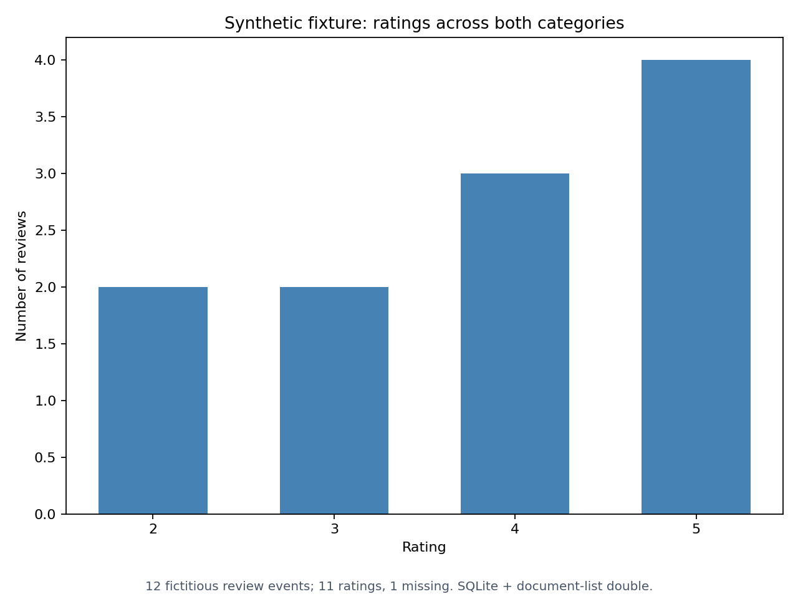

# Amazon review databases

Explore relational, document and graph representations of review data with a
Python loading and analysis pipeline. It loads structured fields into MySQL, review text into MongoDB,
offers seven visualisations and builds four alternative Neo4j graphs. A popularity
query recommends products a user has not reviewed, ranked by review count, mean
rating and product ID. It is an aggregation baseline, not a trained recommender;
an unreviewed product is not necessarily unpurchased.



An offline run of the bundled fictitious reviews through the existing loader and
rating plot: 12 events, including 11 ratings and one missing rating. It uses the
test suite's SQLite adapter and document-list double, without external database
services. Reproduce with `python preview.py` after installing the requirements.

**Technical focus:** event-preserving data modelling, validation and partial-write
reporting, SQL aggregation, document storage and graph similarity. Python,
PyMySQL, PyMongo, the Neo4j driver and Matplotlib; detailed service instructions
are in [Database usage](docs/database-usage.md).

## Try it without databases

Python 3.12; tested with 3.12.14. From this folder:

```bash
python -m venv .venv
source .venv/bin/activate
python -m pip install -r requirements.txt
python load_data.py validate --file data/synthetic_books.jsonl --category demo_books
python load_data.py validate --file data/synthetic_sports.jsonl --category demo_sports
python -m unittest discover -s tests -v
```

On Windows, activate with `.venv\Scripts\activate`. These checks do not contact
services. The [fixtures](data/README.md) are **entirely synthetic**: nine book
events and three sports events, involving three fictitious reviewers and six
items. They include repeated ratings and a missing rating.

## Run with local services

**Real MySQL, MongoDB and Neo4j integration remains unverified.** Provide disposable
MySQL and MongoDB stores named `amazon_reviews_demo`, plus an existing Neo4j
database named `amazon-reviews-demo`. The application does not create that Neo4j
database and rejects the default `neo4j` name. Provision an installation supporting
the dedicated name. No server versions have been tested.

Use accounts limited to these stores. [Database usage](docs/database-usage.md)
provides environment variables, initialisation and loading commands, and recovery
steps. Copy the fictitious values in `.env.example` into a private `.env`, replace
them with your local credentials, then export them; the application does not load
`.env` automatically. Connections accept loopback endpoints only.

`load_data.py init` creates missing objects without dropping data. Loading refuses
categories already present. Each graph model requires an empty graph and does
not clear it automatically. The usage guide includes explicit reset commands
that **delete demonstration data**.

## Results and limits

Local checks produced 3 users, 6 items and 12 review events in SQLite, alongside
12 documents in a MongoDB double. These are fixture results, not successful
MySQL/MongoDB integration or throughput measurements. Graph doubles do not
validate Cypher against Neo4j.

Reviews remain events, including repeated user/item pairs. Recommendation
categories come from review rows. Graph ratings average each pair's non-null
ratings; similarity centres users on all their aggregated item ratings, rather
than recomputing Pearson means only on shared items.

MySQL and MongoDB have **no shared transaction**. Failures may leave partial or
uncertain writes and retain earlier batches. Inspect the report before recovery;
there is no automatic retry. [Database usage](docs/database-usage.md) explains
engine configuration, aggregation conventions, failure reports and the explicit,
**destructive** demo reset. Real datasets are not included.

## Tests and version notes

The test command above runs 20 tests covering validation, partial loads,
uncertain commits, category reuse, resource cleanup, resets, rating aggregation,
neighbour counts, popularity queries and all seven plots. SQL checks use SQLite
with adapted placeholders; graph and document clients are doubles. They do not
validate server permissions, MySQL DDL/collation, wire protocols or Cypher.

Post-submission corrections replaced embedded credentials, made resets explicit
and improved failure reporting. They also fixed category discovery for reused
products and resource cleanup after a failed query, while retaining review
events, the schema and the coursework similarity formula.

## Academic context and credits

A two-student team project for the Databases course, iMAT, ICAI,
Universidad Pontificia Comillas. The project uses the
MySQL, MongoDB and Neo4j Python clients;
Matplotlib and wordcloud support the plots.
